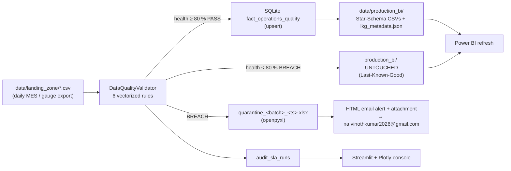
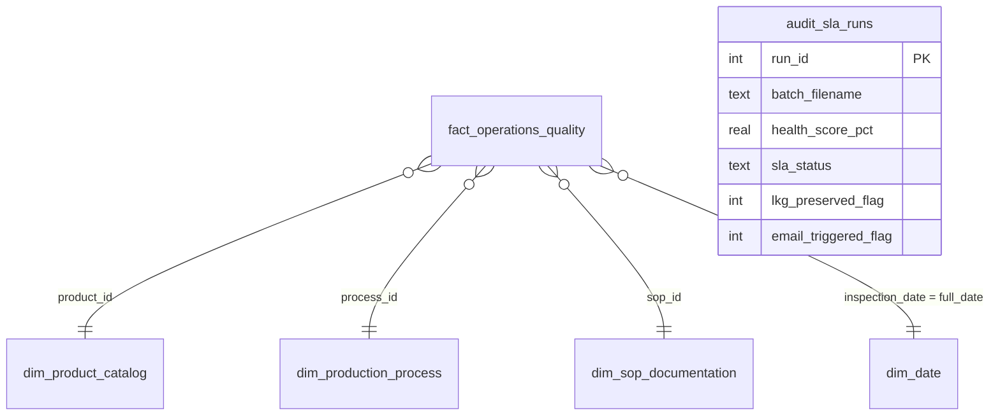

# Enterprise Operations Quality — Pre-BI Data Validation Gatekeeper, SLA Monitor & Document Traceability Pipeline

Stops corrupted daily operational uploads from breaking the morning executive **Power BI** dashboards.
Every batch passes a **6-rule vectorized quality gate** with an **80.0 % Data Quality SLA**. If a batch fails, Power BI keeps serving the **Last-Known-Good (LKG)** snapshot, the bad rows go to an Excel quarantine workbook, and an HTML alert will be sent to respective email(for now it is configured with na.vinothkumar2026@gmail.com).

Runs natively on **macOS** with Python `venv`. No Docker, cloud services or database server required.

---

## 1. Architecture



### Validation rules (`src/validator.py`)

| Rule | Check |
|---|---|
| `RULE_01_PK_DUPLICATE` | `inspection_id` duplicated in the batch, or already in production from another batch |
| `RULE_02_CRITICAL_NULL` | Null in `inspection_id`, `batch_id`, `product_id`, `process_id`, `sop_id`, `measurement_mm` |
| `RULE_03_FK_ORPHAN` | `product_id` / `process_id` / `sop_id` not found in the master dimensions |
| `RULE_04_SCHEMA_TYPE` | Non-numeric `measurement_mm` / `cycle_time_sec`, or `inspection_date` that can't be parsed |
| `RULE_05_RANGE_ANOMALY` | `cycle_time_sec <= 0`, or `measurement_mm < 0` or `> 1000` |
| `RULE_06_SOP_COMPLIANCE` | Inspection points to an **Expired** SOP / work instruction |

`health_score_pct = valid_rows / total_rows × 100`. The SLA passes when the score is **≥ 80.0 %**.
Re-running the **same** batch is idempotent: that batch's own rows in production are replaced rather than flagged as duplicates.

### SQLite Star Schema (`db/ops_quality_gatekeeper.db`)



---

## 2. Quick start (macOS)

```bash
cd ops-quality-data-gatekeeper
python3 -m venv .venv
source .venv/bin/activate
pip install -r requirements.txt

python -m src.data_generator            # seed DB, LKG snapshot, landing batches (--force to rebuild)
python -m src.pipeline                  # healthy (96.4 % PASS) then corrupted (71.2 % BREACH)
pytest -q                               # 35 tests

./run_app.sh                            # → http://localhost:8501
```

Other pipeline commands:

```bash
python -m src.pipeline data/landing_zone/batch_2026_10_31_corrupted.csv
python -m src.pipeline --auto-fix data/landing_zone/batch_2026_10_31_corrupted.csv   # remediate + promote
```

### Demo batches

| File | Rows | Valid | Health | Result |
|---|---|---|---|---|
| `batch_2026_10_30_healthy.csv` | 500 | 482 | **96.4 %** | ✅ PASS: promoted to Power BI |
| `batch_2026_10_31_corrupted.csv` | 500 | 356 | **71.2 %** | 🚨 BREACH: LKG kept, Excel quarantine, email alert |

Failures injected into the corrupted batch: 30 PK duplicates (15 within the batch, 15 already in production), 28 critical nulls, 26 `process_id` FK orphans, 10 type errors, 30 range anomalies and 20 rows that use an Expired SOP.

---

## 3. Power BI Last-Known-Good workflow

1. In Power BI Desktop, choose **Get Data → Text/CSV** and load the five files in `data/production_bi/`:
   `Fact_Operations_Quality`, `Dim_Product_Catalog`, `Dim_Production_Process`, `Dim_SOP_Documentation`, `Dim_Date`.
2. Create these relationships: `Fact[product_id] → Dim_Product_Catalog`, `Fact[process_id] → Dim_Production_Process`, `Fact[sop_id] → Dim_SOP_Documentation`, `Fact[date_key] → Dim_Date[date_key]`.
3. Schedule the Gatekeeper to run **before** the Power BI refresh (for example with `cron` or `launchd` at 05:30).
4. **PASS:** the CSVs are rewritten and `lkg_metadata.json` is set to `stale_warning: false`.
   **BREACH:** the CSVs are **not modified**, so the dashboards show yesterday's certified data. `lkg_metadata.json` gets `stale_warning: true` and `last_failed_batch`, which you can display as a "data freshness" banner card in Power BI.

---

## 4. Email alerts

* Subject: `[URGENT - Ops Quality Gatekeeper] Daily Data SLA Breach (71.2% < 80.0% Target) — Power BI Locked to LKG`
* Body: a batch summary table, a rule-by-rule breakdown, confirmation that the LKG lock is in place, and remediation steps. The `.xlsx` quarantine workbook is attached.
* A copy of each alert is always saved to `data/quarantine/latest_email_alert.html`, with the dispatch status in `latest_email_status.json`.
* **Live sending:** run `cp .env.example .env`, then set `SMTP_SENDER_EMAIL` and a 16-character Gmail **App Password** in `SMTP_APP_PASSWORD`. Mail goes out through `smtp.gmail.com:465` (SSL).
  If these values are missing, or you're offline, the app records *"HTML Alert Generated & Saved Locally"* and keeps running.

---

## 5. Streamlit console (`app.py`)

| Area | Contents |
|---|---|
| Sidebar | Choose a batch or upload a CSV, **Run Daily Validation Gatekeeper**, **Auto-Fix Quarantined Batch & Re-Run**, live Power BI LKG status |
| Tab 1 | SLA status banner, 4 KPI cards, 14-day SLA trend with a red dashed 80 % threshold line, rule Pareto chart |
| Tab 2 | Filterable quarantined rows (`failed_rules`, `failure_reason`) and `.xlsx` download |
| Tab 3 | SOP review cycle time vs SLA, document status donut, Expired SOPs linked to `RULE_06` failures |
| Tab 4 | Recipient, SMTP status, attachment path, live test-email button, embedded HTML preview of the alert |

---

## 6. Project layout

```text
ops-quality-data-gatekeeper/
├── app.py                     Streamlit + Plotly console
├── run_app.sh                 one-command macOS launcher
├── setup_git_history.sh       reproducible commit history
├── src/
│   ├── config.py              paths, 80 % SLA, recipient, .env SMTP
│   ├── database.py            SQLite Star Schema + audit store + BI export
│   ├── data_generator.py      master data, history, LKG snapshot, batches
│   ├── validator.py           6-rule vectorized DataQualityValidator
│   ├── email_alerter.py       HTML alert, attachment, SMTP-SSL / local fallback
│   └── pipeline.py            LKG orchestrator, openpyxl quarantine, auto-fix
├── data/landing_zone | production_bi | quarantine
├── db/ops_quality_gatekeeper.db
└── tests/test_validator.py
```

Author: **Vinothkumar N** · vinothofficial14@gmail.com

